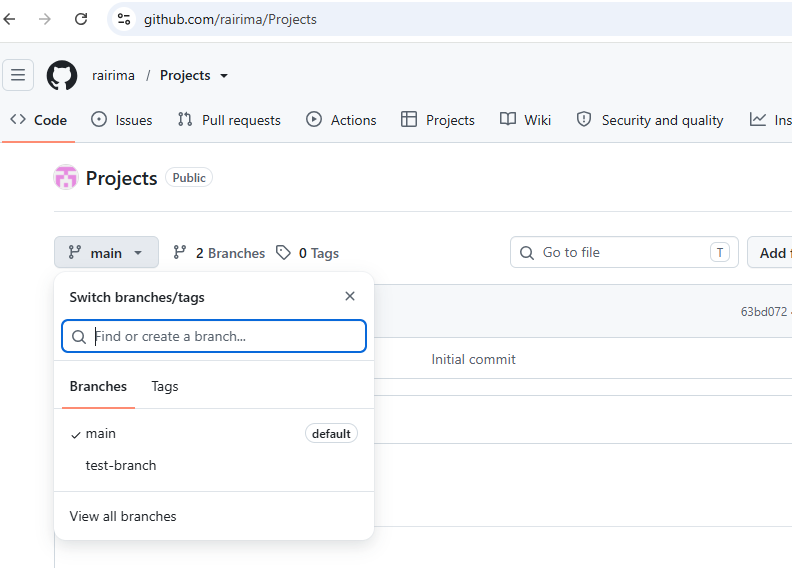
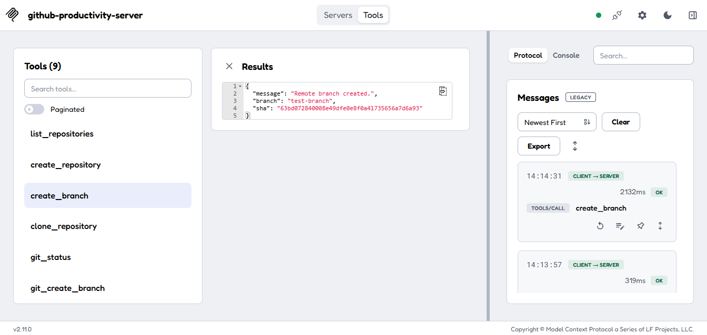
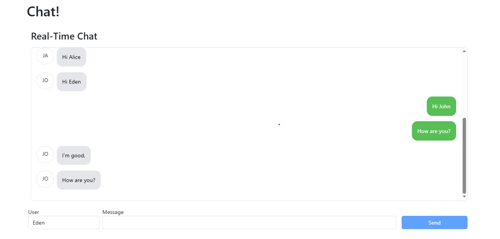
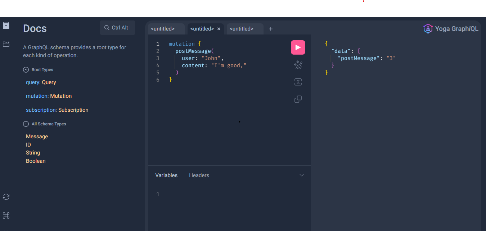
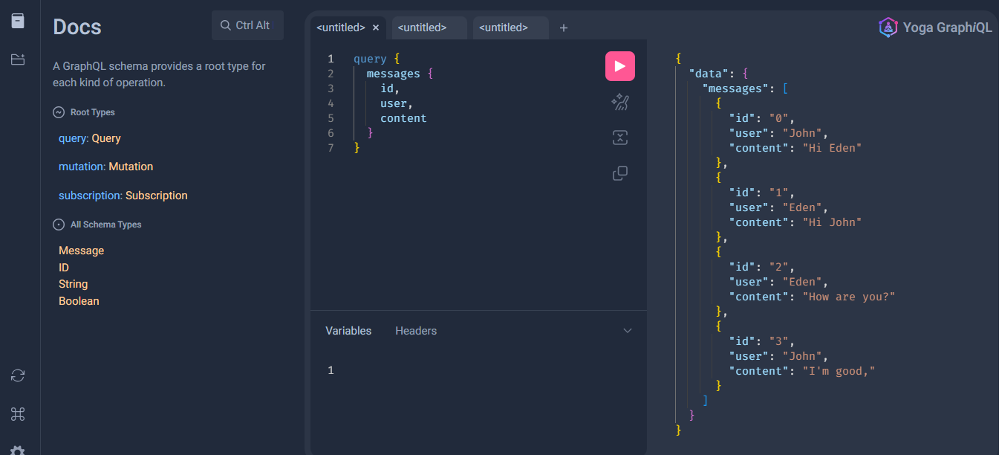

# Projects

# Project-1: Projects\mcp-server-js-example:
It contains a minimal MCP (Model Context Protocol) server example implemented in Node.js. 
It is intended as a starting point for building a server that exposes a small set of safe, discoverable
tools to an AI client using the MCP protocol.

## Overview

Key behaviors implemented by the example server:

1. Configuration: loads secrets and options (GitHub token, workspace directory) from a `.env` file.
2. Validation: restricts repository names, branch names, and file paths to reduce risky operations.
3. MCP registration: each `registerTool()` call exposes a function the AI client can discover and invoke.
4. Octokit: performs authenticated GitHub API requests where needed.
5. simple-git: runs Git operations inside the configured workspace.
6. Standard I/O transport: communicates with the MCP client over stdin/stdout.

The server deliberately operates inside an explicit workspace directory and does not allow arbitrary shell execution or unrestricted filesystem access.

## Quick start

1. Install dependencies:

```bash
npm install
Create a .env file in the project root with the required variables. Example:
env
GITHUB_TOKEN=ghp_xxx                      # token used by Octokit (use least privilege)
WORKSPACE_DIR=/path/to/local/workspace     # local directory where repositories will be cloned
PORT=3000                                  # optional, if your server exposes an HTTP health endpoint
Never commit tokens to source control. For production, prefer a GitHub App with narrowly scoped permissions.

Configure Git authentication
This project uses Octokit for GitHub API requests. Git commands such as clone, pull, and push use your Git credential configuration.

For local development, you can authenticate with the GitHub CLI:

bash
# install: https://cli.github.com
gh auth login
gh auth setup-git
Verify authentication:

bash
gh auth status
git config --get credential.helper
The second command may return nothing if your Git installation uses another credential mechanism; that doesn't necessarily indicate a problem.

Important: never embed a personal access token directly in a repository URL or print it to logs.

Run the server
Start the server from the project directory:

bash
npm start
The process typically stays running without printing normal application logs — stdin/stdout are used for MCP communication.

Inspecting and testing tools
Open a second terminal to run the MCP Inspector so you can interactively discover tools and test them:

bash
npx -y @modelcontextprotocol/inspector node server.js
The Inspector connects to a local MCP server and lets you explore available tools and their input schemas. Follow the Inspector's displayed instructions if it differs by version.
```
Recommended test flow (try these in order):

Try these tools in order:

1. `list_repositories`
2. `create_repository`
3. `clone_repository`
4. `git_status`
5. `git_create_branch`
6. `git_commit`
7. `git_push`

# Image Referneces:




### -------------------------------------------------------

# Project 2: Projects\real-time-chat-app
This project is a real-time chat application built with a React client and a GraphQL server. It demonstrates live messaging using GraphQL subscriptions and an SSE-based Apollo client connection.

# Overview
The app has two main parts:

real-time-chat-app/client: React frontend with Bootstrap styling and Apollo GraphQL client
real-time-chat-app/server: GraphQL Yoga server with in-memory message storage and subscription support
real-time-chat-app/home-page: landing page for the application

This project also uses Webpack Module Federation to expose the chat application as a remote module and load it from the home page application.

# Features
Real-time message updates between clients
User-specific chat bubbles
Send message form with Enter-to-submit support
GraphQL query, mutation, and subscription patterns
Simple in-memory message persistence during runtime

# Tech stack
React
Apollo Client
GraphQL
GraphQL Yoga
GraphQL SSE
Bootstrap
Webpack

# Run the application
1. Start the server
bash
cd real-time-chat-app/server
npm install
npm start
This starts the GraphQL server on:

http://localhost:4000/graphql

2. Start the client
bash
cd ../client
npm install
npm start
This launches the frontend in the browser via the webpack dev server.

# Notes
The chat app uses a lightweight in-memory array on the server for message storage, so messages are not persisted across server restarts. The frontend listens for message subscriptions and updates the chat view automatically whenever new messages are posted.

# Image Refernces:


